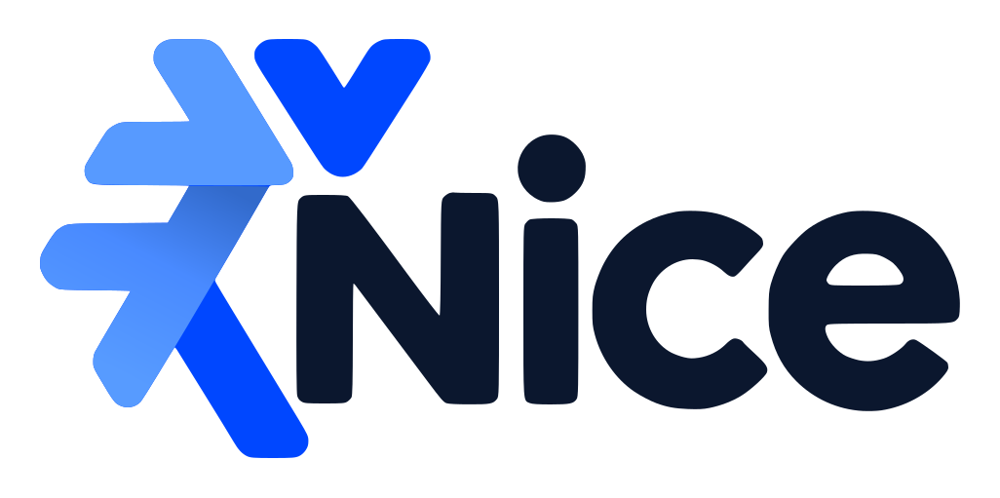

<h1 align="center">
  <picture>
    <source media="(prefers-color-scheme: dark)" srcset="assets/brand/nice-dark.svg">
    <source media="(prefers-color-scheme: light)" srcset="assets/brand/nice-light.svg">
    
  </picture>
</h1>

**NI**x **C**onfigures **E**verything

My NixOS, macOS (nix-darwin) and home-manager configuration in one flake: a Linux laptop, a homelab server, three Macs, and home-manager on remote Linux servers, all for one user. It is built with [den](https://denful.dev/ecosystem/den/): every `.nix` file under `modules/` is a flake-parts module, and features are den aspects that hosts and homes include by name. `flake.nix` is generated by [flake-file](https://github.com/denful/flake-file) from the inputs each module declares: after changing one, run `nix run .#write-flake` and `nix flake lock`.

## Hosts

Every host and home is declared in `modules/hosts.nix`, which says what each one is: the system, host key, secrets and users of a host, and the user and home directory of a standalone home. Each has an aspect, in `modules/hosts/` for NixOS and nix-darwin and in `modules/homes/` for standalone home-manager, that includes a role and holds the configuration only that machine has. The state versions are fleet constants in `modules/den/defaults.nix`.

| Host | Machine | Kind | System | Role | Files |
|---|---|---|---|---|---|
| `nixps` | Dell laptop | NixOS | x86_64-linux | `nixos-workstation` | `modules/hosts/nixps/`: `nixps.nix`, `hardware.nix`, `secureboot.nix`, `touchpad.nix` |
| `nixmachine` | Framework Desktop, homelab server | NixOS | x86_64-linux | `nixos-server` | `modules/hosts/nixmachine/`: `nixmachine.nix`, `hardware.nix`, `disko.nix`, `loudness.nix` |
| `nixair` | Mac | nix-darwin | aarch64-darwin | `darwin-workstation` | `modules/hosts/nixair.nix` |
| `nixmini` | Mac | nix-darwin | aarch64-darwin | `darwin-workstation` | `modules/hosts/nixmini/`: `nixmini.nix`, `shaders/` |
| `nixneo` | Mac | nix-darwin | aarch64-darwin | `darwin-workstation` | `modules/hosts/nixneo.nix` |
| `chameleon` | Chameleon Cloud bare-metal instances (user `cc`) | home-manager | x86_64-linux | `standalone` | `modules/homes/chameleon.nix` |
| `goku` | lab server behind `linux.cs.uchicago.edu` | home-manager | x86_64-linux | `standalone` | `modules/homes/goku.nix` |
| `vegeta` | lab server behind `linux.cs.uchicago.edu` | home-manager | x86_64-linux | `standalone` | `modules/homes/vegeta.nix` |

The roles live in `modules/roles/` (`nixos-workstation.nix`, `darwin-workstation.nix`, `nixos-server.nix`), and the home-manager bundles they build on, `standalone` among them, in `modules/bundles/`.

## Switching

```sh
# NixOS: nixps, nixmachine
sudo nixos-rebuild switch --flake .#<name>

# nix-darwin: nixair, nixmini, nixneo
sudo darwin-rebuild switch --flake .#<name>

# standalone home-manager: chameleon, goku, vegeta
home-manager switch --flake .#<name>

# any of them through nh (nh os, darwin or home), from the repo root; without `-- switch` it only builds
nix run .#<name> -- switch
```

On a first switch, before `darwin-rebuild` or `home-manager` is installed, run `sudo nix run nix-darwin/master#darwin-rebuild -- switch --flake .#<name>` on a Mac and `nix run home-manager/master -- switch --flake .#<name>` on a standalone host.

Before the first switch on goku or vegeta, run `nix run .#sync-rclone-tokens` (hosts as arguments, default goku vegeta) from a machine that decrypts the rclone tokens (a Mac, nixps or nixmachine), so the rclone mounts find them at activation. On a Chameleon node, the rclone step of `agents/skills/chameleon-cloud/scripts/setup-instance.sh` copies them through the same app.
